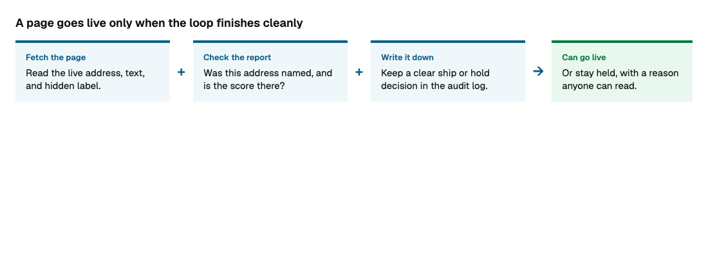
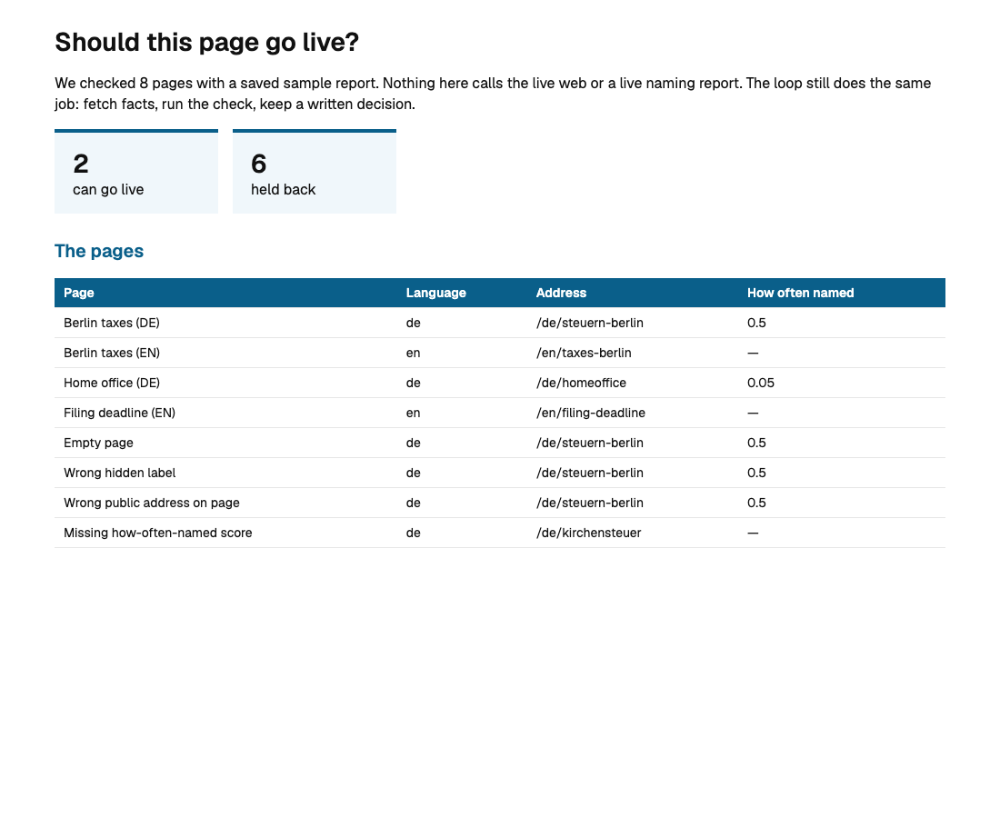
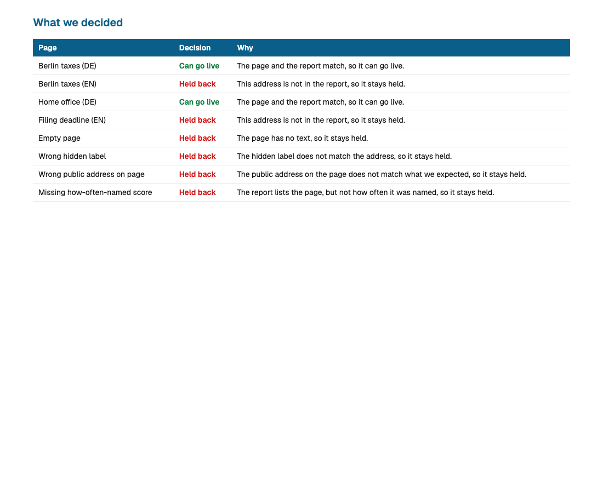

# Publish loop

This is the run: fetch a page, decide with the same three-way check as [content-gate](https://github.com/seancmry/content-gate), and append one line to `out/audit.jsonl`. The line says **can go live** or **held back**, and why. The next person can open the log. They do not have to reconstruct the decision from a chat.

content-gate owns the rule and the database write (`apply_check`). This repo owns the fetch and the audit trail. A saved sample stands in for the live web and the live report, so the loop runs with no account.



## Run it

**Eight sample pages, no API calls:**

```bash
python3 -m venv .venv
source .venv/bin/activate
pip install -r requirements.txt
python experiments.py
```

Some can go live. Some are held on purpose: missing from the report, empty text, a wrong hidden label, or a missing score. A low naming rate still allows the page. A missing rate holds it.





Lab PDF: [docs/publish-loop-lab.pdf](docs/publish-loop-lab.pdf).

**One offline path:**

```bash
python loop.py
```

### Live fetch

Needs `FIRECRAWL_API_KEY` in `.env`. The naming report stays the saved sample unless you wire a live report later.

```bash
python loop.py --live --url https://www.firecrawl.dev
```

### Rebuild the lab screenshots and PDF

```bash
pip install playwright
playwright install chromium
python scripts/make_lab_pdf.py
```

## Inputs

| Input | What the loop does with it |
| --- | --- |
| `fixtures/pages.json` | The queue of addresses to check. |
| `fixtures/live-pages.json` | Saved fetches, so the offline run needs no key. |
| `fixtures/peec-urls.json` | Saved naming report. Same shape as content-gate. |
| `--url` | Check one address. Default is every row in the queue. |
| `--live` | Fetch with Firecrawl. Without `FIRECRAWL_API_KEY`, the script exits. |
| `out/audit.jsonl` | One decision per line: `ship` or `hold`, the reasons, the naming rate, and the time. |

Details are in `VARIABLE_SCHEMA.md`.
